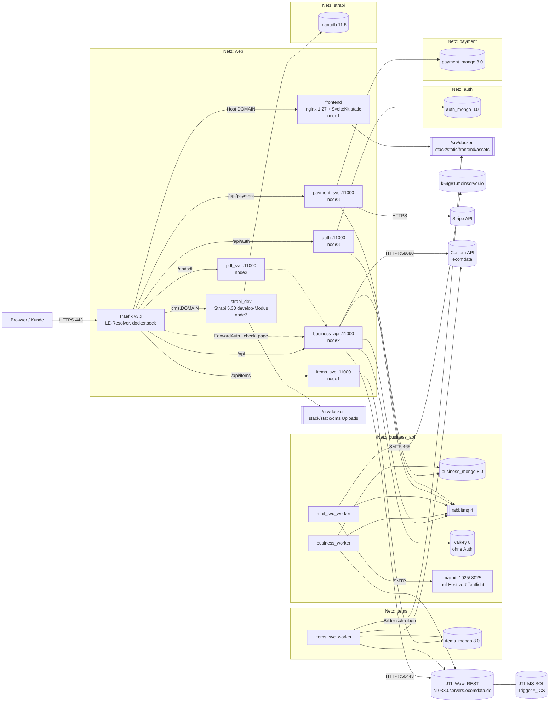

# 06 – Infrastruktur, Deployment & Entwicklungsprozess (Webshop SN24 / sicherheit.meesenburg.com)

Stand der Analyse: 2026-10-07 · Grundlage: Repo `webshop` (Branch `main`, HEAD `9cc4a13`, 308 Commits auf `main`, 365 über alle Branches) · ausschließlich statische Analyse, keine Netzwerkzugriffe, keine Änderungen am Repo.
Alle Fundstellen sind als `Pfad:Zeile` relativ zum Repo-Root angegeben. Secrets sind maskiert (erste 4 Zeichen + „…“).

---

## 1. Zusammenfassung

**Kernaussage:** Wie der Shop in Produktion läuft, lässt sich aus dem Repo **nicht reproduzieren**. Es gibt drei Deployment-Varianten, die sich widersprechen: Swarm-Stack, Compose-„deploy“ und Compose-„dev“. Die laut Readme „richtige“ Datei `docker-compose_deploy.yml` bindet die **Entwicklungs**-Service-Definitionen ein (`compose/services/…`), nicht die Varianten in `compose/services_deploy/…`. Diese Deploy-Varianten enthalten zudem YAML-/Argumentfehler, mit denen drei Services gar nicht starten würden. Der echte Produktivstand liegt also mit hoher Wahrscheinlichkeit nur auf den Servern: als lokale `.env`, als lokal geänderte Dateien unter `/srv/docker-stack` und als Images in einer Registry `zot.local:5000`. Wo die Registry steht, ist unbekannt.

Wichtigste Befunde:

1. **Kein CI/CD.** Es gibt nur eine Gitea-Actions-Pipeline für Frontend-Checks (`.gitea/workflows/frontend_check.yml`). Seit dem Umzug nach Azure DevOps (ca. März 2026) läuft sie nicht mehr. Es gibt keine Azure-Pipelines-Datei, keinen Image-Build, keinen Push, kein Tagging und kein Release. Deployments erfolgen manuell.
2. **Secrets im Klartext im Repo:** im Readme (JTL-Wawi-Token, Custom-API-Token, Stripe-Keys, SMTP-Passwort), in DEVELOPMENT.md (Strapi-Transfer-Token), in Compose-Defaults (Strapi-JWT/APP_KEYS), in `cms/strapi_cms/.env` (bewusst per `.gitignore`-Ausnahme eingecheckt) und als TLS-Private-Keys unter `traefik/data/*.key`. Alle Secrets gelten als kompromittiert und müssen rotiert werden.
3. **Single Points of Failure überall:** Jeder Service läuft mit genau einem Replikat und ist per Placement fest an `node1`/`node2`/`node3` gebunden. Es gibt vier Mongo-Einzelinstanzen ohne Replica-Set, eine MariaDB, eine RabbitMQ und eine Valkey, alle auf Host-Bind-Mounts. **Backups kommen im Repo nicht vor.** Healthchecks hat nur Valkey, Ressourcenlimits fehlen ganz.
4. **Starke Abhängigkeiten zum insolventen Dienstleister (sustainable-solutions.it):** Let's-Encrypt-Account-Mail, Strapi-„Global“-Instanz `cms.sn24.sustainable-solutions.it`, Nextcloud für Static Assets und DB-Dumps, Gitea (SSH-Port 2221), Commit-Identitäten, vermutlich auch die Image-Registry und die Server selbst. Dazu kommt eine Kern-Python-Bibliothek `svc_helper` aus einem **GitLab-Repo eines Entwicklers** (`gitlab.com/vitandi1/svc_helper`, öffentlich, jederzeit entziehbar). Wird es gelöscht oder privat gestellt, lässt sich kein Backend-Image mehr bauen. Kopie seit 07.10.2026 unter `referenz/svc_helper`.
5. **Konfigurationsfehler mit Prod-Relevanz:** `MONGO__*` wird an keinen Service übergeben, die Apps verbinden sich also mit den Code-Defaults (Benutzer und Passwort, beide maskiert: `user`/`pw12…`). Weitere Fehler: `MONGO_PASSWORD` wird aus der Variable für den Benutzernamen befüllt, `CUSTOM_API__TOKEN` ist der falsche Variablenname, Auth läuft auch im Deploy mit hartem `SECURITY__KEY` (`foob…`), und Mail-Variablen werden im Swarm-Stack nicht korrekt gemappt.
6. **Prozess:** Seit dem Go-Live (Juni 2026) enthalten **65 %** der Commits „fix“-Begriffe, vorher waren es 26 %. Aktiv sind nur noch zwei Entwickler: Seidel (inkl. Alias „vitandi“) und Bräuer. Code Review lässt sich aus Git nicht nachweisen; PR-Ersteller und Merger sind regelmäßig dieselbe Person. 34 Direkt-Pushes auf `main` (11 %), auch Infrastruktur-Änderungen, der letzte am 2026-08-21.
7. **AKS-Readiness: gering.** Die Python-Images enthalten keinen Code, denn er kommt per Bind-Mount. Es gibt kein `CMD`, keinen Non-Root-User und keine Probes. Logs gehen in Dateien statt auf stdout. Die Frontend-Images haben Build-Time-Secrets, Strapi läuft im `develop`-Modus. Routing hängt an Traefik-Labels, Persistenz an Host-Pfaden.

---

## 2. Laufzeit-Topologie

### 2.1 Deployment-Varianten im Repo (widersprüchlich)

| Variante | Datei | Inhalt | Bewertung |
|---|---|---|---|
| A – Dev-Compose | `docker-compose.yml:11-14` | inkludiert `compose/services/{dev_reverse_proxy,frontend,backend}.yml`; nginx-Dev-Proxy, Vite-Dev-Server, `--reload`, Mongo-Express ohne Auth | nur für Entwicklung |
| B – „Deploy“-Compose (laut Readme maßgeblich) | `docker-compose_deploy.yml:7-10`, `Readme.md:4-9` | inkludiert **dieselben Dev-Dateien** `compose/services/…`, nur Netzwerk `web` extern | widerspricht dem Zweck, so nicht produktionstauglich |
| C – „services_deploy“ | `compose/services_deploy/**` | Varianten mit `--workers 20`, Let's-Encrypt-Resolver, ohne DB-Viewer | **wird von keiner Top-Level-Datei referenziert**; Syntaxfehler in `items_svc.yml:23`, `payment_svc.yml:22`, `pdf_svc.yml:23` (`--workers", "20"`, Anführungszeichen fehlt, uvicorn bekommt das Argument `--workers"`) und falscher Build-Kontext in `mail_svc.yml:4` (`items_svc` statt `mail_svc`) |
| D – Docker Swarm Stack | `docker-stack.yml` | 3 Nodes (`node1..3`), Images aus `${REGISTRY:-zot.local:5000}/sn24_*:${IMAGE_TAG}`, Bind-Volumes unter `${BASE_PATH:-/srv/docker-stack}` | einzige Variante mit Registry/Tags; enthält **keinen Traefik-Service** |

Commit-Historie: Der Swarm-Stack kam am 2026-01-11 dazu, die Deploy-Compose-Dateien am 2026-03-05. Beide Commits stammen von „vitandi“ und gingen per Direkt-Push auf `main`. Welche Variante heute produktiv läuft, ist aus dem Repo **nicht eindeutig ableitbar**. Readme und Commit-Reihenfolge sprechen für B oder C mit lokalen Anpassungen auf dem Server. Das Image-Schema in D (`sn24_*`) spricht für Swarm. Das muss mit den Freelancern geklärt werden (siehe I-01).

### 2.2 Container/Services (Basis: `docker-stack.yml`, ergänzt um Compose)

| Service | Image / Version | Port (intern) | Netzwerke | Volumes / Persistenz | Abh. | Healthcheck | Limits | Replikas / Placement | Fundstelle |
|---|---|---|---|---|---|---|---|---|---|
| traefik | `traefik:v3.3` (dev) / `v3.6` (deploy) | 80, 443 (Host) | web | `/var/run/docker.sock`, `./traefik` (Config, `acme.json`, Logs) | – | – | – | 1 (nicht im Stack; „globaler Traefik“ laut Readme) | `compose/services/traefik.yml:5`, `compose/services_deploy/traefik.yml:5`, `Readme.md:11-12` |
| dev_reverse_proxy | `nginx:1.27` | 80, 443 (Host) | web, business_api | nginx-Conf, Self-Signed-Certs aus `traefik/data` | – | – | – | 1 | `compose/services/dev_reverse_proxy.yml:5-18` |
| frontend | eigenes Image `sn24_frontend` (node:23.5-Build → `nginx:1.27`) | 80 | web | `static/frontend/assets` (Bind), Logs | (Traefik) | – | – | 1 / node1 | `docker-stack.yml:146-172`, `frontend/Dockerfile` |
| frontend_dev | `frontend/Dockerfile.dev` (node:23.5, `vite dev`) | 5173 | web | Quellcode-Bind | – | – | – | 1 | `compose/services/frontend/main_dev.yml` |
| items_svc | `sn24_items_svc` (python:3.13-slim) | 11000, root-path `/api/items`, 4 Worker | web, items | Logs, `shop_items` (ro) | items_mongo | – | – | 1 / node1 | `docker-stack.yml:174-213` |
| items_svc_worker | `sn24_items_svc` (`python src/jtl/worker.py`) | – | web, items | Logs, `shop_items` (rw, Bilder ins Frontend-Asset-Verzeichnis) | items_mongo, JTL | – | – | 1 / node1 | `docker-stack.yml:215-239` |
| items_mongo | `mongodb/mongodb-community-server:8.0-ubi8` | 27017 | items | `/srv/docker-stack/persistence_files/items/db/data` | – | – | – | 1 / node1 | `docker-stack.yml:241-265` |
| business_api | `sn24_business_api` | 11000, root-path `/api`, 4 Worker (Compose-deploy: 20) | web, business_api | Logs; **Bestell-Anhänge in `src/…/resources/order_attachments` ohne Volume** | business_mongo, rabbitmq, cache, JTL, Custom API | – | – | 1 / node2 | `docker-stack.yml:270-307`, `backend/business/src/business_api/core/config.py:55` |
| business_worker | `sn24_business_api` (`worker.py`) | – | web, business_api | Logs | rabbitmq, business_mongo, JTL | – | – | 1 / node2 | `docker-stack.yml:309-332` |
| business_mongo | mongodb-community-server:8.0-ubi8 | 27017 | business_api | `persistence_files/business_api/db` | – | – | – | 1 / node2 | `docker-stack.yml:334-358` |
| rabbitmq | `rabbitmq:4-management` | 5672, 15672 (dev: 11012/11010 auf Host) | business_api, auth, payment | `backend/rabbit_mq/dbs` | – | – | – | 1 / node2 | `docker-stack.yml:360-384`, `compose/services/backend/message_queue.yml:7-9` |
| cache (Valkey) | `valkey/valkey:8-bookworm` | 6379 (dev: 11020 auf Host) | business_api | `valkey/data`, `valkey/logs`, **leere** `valkey.conf` | – | **ja** (`redis-cli ping`, 30 s) | – | 1 / node2 | `docker-stack.yml:386-419`, `backend/valkey/valkey.conf` (0 Byte) |
| auth | `sn24_auth_svc` | 11000, root-path `/api/auth` | web, auth | Logs | auth_mongo, rabbitmq | – | – | 1 / node3 | `docker-stack.yml:424-461` |
| auth_mongo | mongodb-community-server:8.0-ubi8 | 27017 | auth | `persistence_files/auth/db/data` | – | – | – | 1 / node3 | `docker-stack.yml:463-487` |
| payment_svc | `sn24_payment_svc` | 11000, root-path `/api/payment` | web, payment | Logs | payment_mongo, Stripe | – | – | 1 / node3 | `docker-stack.yml:489-526` |
| payment_mongo | mongodb-community-server:8.0-ubi8 | 27017 | payment | `persistence_files/payment/db/data` | – | – | – | 1 / node3 (ohne Logging-Labels) | `docker-stack.yml:528-549` |
| strapi_dev (CMS) | `sn24_strapi` (Dockerfile: node:20-slim, `npm run develop`) | 1337 | web, strapi | `static/cms` → `/opt/app/public` (Uploads) | strapi_db | – | – | 1 / node3 | `docker-stack.yml:551-592`, `cms/strapi_cms/Dockerfile:21-41` |
| strapi_db | `mariadb:11.6` | 3306 | strapi | `cms/db/data`, Init-Dump `cms/db/init/strapi.sql` | – | – | – | 1 / node3 | `docker-stack.yml:594-618` |
| pdf_svc | `sn24_pdf_svc` | 11000, root-path `/api/pdf` | web, business_api | Templates (ro), schreibt in **business_logs** | – | – | – | 1 / node3 | `docker-stack.yml:620-658` |
| mailpit | `axllent/mailpit:latest` | **1025, 8025 auf Host veröffentlicht** | web, business_api | – | – | – | – | 1 / node3 | `docker-stack.yml:660-677` |
| mail_svc_worker | `sn24_mail_svc` (`worker.py`) | – | web, business_api | Logs | rabbitmq, SMTP | – | – | 1 / node3 | `docker-stack.yml:679-704` |
| redis_commander, 4× mongo-express | `ghcr.io/joeferner/redis-commander:0.9`, `mongo-express` (ohne Tag) | 11021–11025 auf Host | dev_view + DB-Netze | – | – | – | – | nur Dev (`ME_CONFIG_BASICAUTH=false`) | `compose/services/backend/db_viewer.yml:10-80` |

**Datenbanken:**
- **MongoDB 8.0:** 4 getrennte Einzelinstanzen (items, business, auth, payment), kein Replica-Set, Root-User per `MONGO_INITDB_ROOT_*`.
- **MariaDB 11.6:** nur für Strapi. Ein Init-Dump mit 620 KB wird inklusive Admin-User-Hash und API-/Transfer-Token-Tabellen versioniert (`cms/db/init/strapi.sql:538`, `:3248`, `:3678`).
- **Valkey 8:** Konfigurationsdatei leer. Die Umgebungsvariable `VALKEY_CONFIG` wird vom offiziellen Image nicht ausgewertet. Valkey startet daher mit Defaults: ohne Passwort und mit Datenverzeichnis `/data`, während das Volume auf `/valkey/data` gemountet ist. **Die Persistenz greift damit vermutlich nicht.** Wer Valkey nutzt, ist im Repo-Code nicht sichtbar, vermutlich die externe `svc_helper`-Lib (`redis[hiredis]` in `backend/auth_svc/uv.lock:658-668`).
- **PostgreSQL:** wird nicht eingesetzt (in `cms/strapi_cms/config/database.ts:25` nur als Strapi-Option vorhanden).
- **Extern:** JTL-Wawi (MS SQL). Für sie liegen DB-Trigger im Repo-Root (`trigger_up.sql`, `trigger_down.sql`, Tabelle `SalesOrderChanges`, Trigger `Verkauf.trg_tAuftrag_ICS` u. a.). Diese Trigger werden **in der ERP-Datenbank** installiert und gehören damit zum Betrieb, sind aber nicht dokumentiert.

**Backups:** Im Repo gibt es **keine** Backup-Jobs, -Skripte oder -Dokumentation. Die einzige Spur sind DB-Dumps für Entwickler auf der Nextcloud des Alt-Dienstleisters (`Readme.md:127-132`).

### 2.3 Routing (Traefik / nginx)

| Pfad / Host | Ziel | Middleware | TLS | Fundstelle |
|---|---|---|---|---|
| `Host(${DOMAIN})` | frontend:80 | Stack/Deploy: `auth` (BasicAuth-Definition **auskommentiert**, Middleware existiert nicht, Router fällt aus); Dev-`main.yml`: `handle-410`, `check-404` (ForwardAuth auf `business_api:11000/_check_page` bei **jedem** Seitenaufruf) | websecure + `lets_encrypt` | `docker-stack.yml:165-170`, `compose/services_deploy/frontend/main.yml:20-26`, `compose/services/frontend/main.yml:20-27` |
| `Host && PathPrefix(/api)` | business_api:11000 | Compose: StripPrefix `/api`; Stack: **ohne** StripPrefix, ohne Entrypoint/TLS | Compose: TLS + LE; Stack: Default (alle Entrypoints) | `compose/services/backend/business_api.yml:45-51`, `docker-stack.yml:304-305` |
| `/api/auth` | auth:11000 | StripPrefix (Compose) | wie oben | `compose/services/backend/auth.yml:38-44`, `docker-stack.yml:458` |
| `/api/items` | items_svc:11000 | StripPrefix (Compose) | wie oben | `compose/services/backend/items_svc.yml:36-42`, `docker-stack.yml:210` |
| `/api/payment` | payment_svc:11000 | StripPrefix (Compose) | wie oben | `compose/services/backend/payment_svc.yml:37-43`, `docker-stack.yml:523` |
| `/api/pdf` | pdf_svc:11000 | StripPrefix (Compose) | wie oben | `compose/services/backend/pdf_svc.yml:35-41`, `docker-stack.yml:655` |
| `Host(cms.${DOMAIN})` | strapi_dev:1337 | – | websecure (+LE im Deploy) | `docker-stack.yml:587-590`, `compose/services/frontend/cms.yml:44-47` |
| `Host(traefik.${DOMAIN})` | api@internal (Dashboard) | – | websecure; `api.insecure: true` | `compose/services/traefik.yml:21-25`, `traefik/traefik.yml:1-3` |

TLS: `traefik/traefik.yml` leitet HTTP→HTTPS um (`:5-12`). Der ACME-TLS-Challenge-Resolver `lets_encrypt` ist auf die Mail-Adresse **c.seidel@sustainable-solutions.it** registriert (`traefik/traefik.yml:60-65`). Zusätzlich stehen statisch Self-Signed-Zertifikate für `localhost`, `cms.localhost` und `traefik.localhost` im Repo, **inklusive Private Keys** (`traefik/dynamic/tls.yml:5-11`, `traefik/data/*.key`). Die TLS-Mindestversion ist auskommentiert (`traefik/traefik.yml:18-20`).

Technischer Hinweis zum Stack: Traefik ist nur mit `providers.docker` konfiguriert, nicht mit `providers.swarm` (`traefik/traefik.yml:22-25`). Die Labels in `docker-stack.yml` stehen auf Container- statt auf `deploy.labels`-Ebene. Ein Traefik auf einem Node sieht damit nur die lokalen Container. Mit drei Nodes kann das Routing für Services auf anderen Nodes so nicht funktionieren, es sei denn, auf dem Server weicht die Konfiguration ab. **Muss verifiziert werden.**

Frontend → CMS: Das Frontend leitet die CMS-URL zur Laufzeit als `cms.<aktueller Host>` ab (`frontend/src/lib/utils/getCmsUrl.ts:1-9`), optional über `VITE_STRAPI_URL` (`frontend/src/lib/api/StrapiManager.ts:51`). Strapi muss also unter genau dieser Subdomain erreichbar sein.

### 2.4 Topologie-Diagramm

### 2.5 Wo läuft das heute? (nur aus dem Repo abgeleitet)

| Artefakt | Wert | Fundstelle | Bemerkung |
|---|---|---|---|
| Live-Domain Shop | `sicherheit.meesenburg.com` | `frontend/src/app.html:13,72`, `backend/mail_svc/src/mail/templates/*.html:34`, `frontend/src/lib/components/Footer/Footer.svelte:441` | CookieFirst-Consent und Händlerbund sind auf diese Domain registriert |
| CMS-Domain | `cms.sicherheit.meesenburg.com` | Frontend-Quellcode (3 Treffer), Ableitung `getCmsUrl.ts` | |
| `DOMAIN` laut Readme | `mb-sn24.meesenburg.de` | `Readme.md:16` | vermutlich Staging oder Altstand |
| Alte Domain beim Dienstleister | `mb-sn24.sustainable-solutions.it` | `backend/google.xml` (`<link>` im Channel) | |
| Strapi-„Global“-Instanz | `cms.sn24.sustainable-solutions.it` | `DEVELOPMENT.md:58,68` | beim insolventen Dienstleister |
| Hosts | Swarm-Nodes `node1`, `node2`, `node3`; Basis-Pfad `/srv/docker-stack` | `docker-stack.yml:32-140,160,298,452` | Provider/Standort nicht ersichtlich |
| Registry | `zot.local:5000` (Default) | `docker-stack.yml:147` u. a. | lokaler Zot, Standort unbekannt |
| ERP (JTL-Wawi) | `c10330.servers.ecomdata.de:50443` (REST, **http**), `:58080` (Custom API, **http**) | `Readme.md:17,21` | Hoster ecomdata |
| SMTP | `k69g81.meinserver.io:465`, Absender `info@sicherheitstechnik-nord.de` | `Readme.md:27-34` | |

---

## 3. Build & CI/CD

| Thema | Befund | Fundstelle |
|---|---|---|
| Pipelines | Nur **Gitea Actions** `frontend_check.yml`: bei PR auf beliebige Branches `npm run check`, `npm run lint`, `npm run test`. Node wird per `curl | bash` (nvm) installiert. **Kein Backend, kein Build, kein Deploy.** | `.gitea/workflows/frontend_check.yml:1-75` |
| Azure Pipelines | **Nicht vorhanden** (keine `azure-pipelines.yml`, keine GitHub/GitLab-CI). Seit dem Wechsel nach Azure DevOps (Remote: `dev.azure.com/Meesenburg-Group/Sicherheit und Service/_git/WebshopSicherheitUndService`) läuft die Gitea-Pipeline nicht mehr, **CI ist faktisch tot**. | `git remote -v` |
| Tests | Frontend: 1 Testdatei (`frontend/src/demo.spec.ts`, Demo). Backend: auth_svc 44 Testfunktionen, business 11 (`test_payment.py`), payment_svc 1 (Health), items/mail/pdf **0**. Backend-Tests laufen nirgends automatisch. | `backend/*/scripts/test.sh` |
| Lint/Format | pre-commit (lokal, optional), nur Frontend, läuft per `docker compose run frontend_dev`. Backend: `scripts/check.sh` (ruff, mypy) nur manuell. | `.pre-commit-config.yaml:1-41`, `backend/business/scripts/check.sh` |
| Image-Build | Nur über `docker compose build`. Registry-Push, Tag-Vergabe (`IMAGE_TAG`, kein Default) und Deploy sind **nicht** automatisiert, Skripte dafür fehlen. | `docker-stack.yml:147` |
| Registry | `zot.local:5000` (privat, Standort unbekannt) | `docker-stack.yml:147` |
| Versionierung | **Keine Git-Tags**, keine Releases, kein Changelog, keine App-Versionen im Image | `git tag` (leer) |
| Reproduzierbarkeit | Python: `uv.lock` + `--frozen` (gut). Abhängigkeit `svc-helper` aus `gitlab.com/vitandi1/svc_helper.git@5e65dee9` (Repo einer Person, öffentlich, jederzeit entziehbar). Frontend: `npm install` statt `npm ci`. Base-Images teilweise `latest`/ohne Tag (mailpit, mongo-express). | `backend/*/pyproject.toml:24`, `frontend/Dockerfile:8` |
| Build-Probleme in den Dockerfiles | Python-Dockerfiles: **kein `COPY src`**, kein `CMD`/`ENTRYPOINT`, kein `USER`, kein `EXPOSE`. `--chown=app:app`, obwohl der User `app` nicht existiert. `git` im Builder wegen der Git-Dependency. Der Code kommt in Compose per Bind-Mount. Der Kommentar im Stack „src removed (code in image)“ (`docker-stack.yml:180`) passt nicht zu den Dockerfiles: Die produktiven Images werden offenbar anders gebaut als im Repo beschrieben. | `backend/*/Dockerfile` |
| Frontend-Build | Multi-Stage (node:23.5 → nginx:1.27), `USER nginx`. Stripe Publishable Key als Build-Arg (pro Umgebung ein eigenes Image). Prerendering der Seiten beim Build. | `frontend/Dockerfile:1-16`, `frontend/svelte.config.js` |
| Strapi-Build | Compose/Stack nutzen `Dockerfile` (node:20-slim, **`npm run develop`**). Das existierende `Dockerfile.prod` (Multi-Stage, `npm run start`) wird nicht benutzt. Node 20 ist seit 04/2026 EOL. | `cms/strapi_cms/Dockerfile:21-41`, `cms/strapi_cms/Dockerfile.prod` |

**Wie wird deployed?** Laut Readme mit `docker compose -f docker-compose_deploy.yml up -d` auf einem Server, dessen `.env` lokal liegt (`Readme.md:4-9`). Alternativ wird mit `docker stack deploy` und Images aus `zot.local` gearbeitet. Die Images werden manuell gebaut und getaggt. Rollback, Blue/Green oder Migrationsschritte sind nicht beschrieben.

---

## 4. Konfiguration (Umgebungsvariablen je Service)

Mechanik: Die Python-Services nutzen `pydantic-settings` mit `env_nested_delimiter="__"`, also z. B. `MONGO__PASSWORD` → `settings.mongo.password`. Das Swarm-Stack lädt **dieselbe** `.env` in **alle** Services (`env_file: .env`). Die Compose-Varianten setzen dagegen nur explizit gelistete Variablen.

### 4.1 Backend-Services

| Service | Variable | Zweck | Pflicht | Default / Wert (maskiert) | Fundstelle / Anmerkung |
|---|---|---|---|---|---|
| alle | `TZ`, `UID`, `GID` | Zeitzone, User | nein | `Europe/Berlin`, `1000` | Compose |
| auth | `SECURITY__KEY` | JWT-Signaturschlüssel | **ja** | Code: `abc1…`; Compose (dev **und** deploy): `foob…` hart codiert | `backend/auth_svc/src/auth/core/config.py:12`, `compose/services_deploy/backend/auth.yml:29` |
| auth | `SECURITY__ISSUER`, `SECURITY__AUDIENCE`, `SECURITY__EXPIRES_DELTA`, `…REFRESH_TOKEN_EXPIRE` | JWT-Claims/Laufzeiten | nein | `Meesenburg`, `["Meesenburg","ICS"]`, 900 s, 24 h | `config.py:11-25` |
| auth | `MONGO__HOST/USERNAME/PASSWORD` | Mongo-Zugang | **ja** | `auth_mongo` / `user` / `pw12…` (Code) – **wird von keiner Compose-Datei gesetzt** | `config.py:28-31` |
| auth | `MESSAGE_QUEUE__USER/PASSWORD` | RabbitMQ | ja | `user` / `pw12…` hart in Compose | `compose/services/backend/auth.yml:31-32` (Auswertung in externer `svc_helper`) |
| auth, items, mail | `DOMAIN` | Basis-URL für Links | ja | `localhost` | |
| business_api / worker | `JTL__DOMAIN` | JTL-REST-Basis | **ja** | `http://localhost…` (Code); Readme: `http://c10330…:50443` | `backend/business/src/business_api/core/config.py:33-39` |
| business_api / worker / items | `JTL__API_TOKEN` | JTL-Token | **ja (Secret)** | Readme: `Wawi…` (Klartext) | `Readme.md:18` |
| business_api / worker / items | `JTL__APP_ID`, `JTL__APP_VERSION` | JTL-App-Registrierung | ja | `icsTest/v3`, `1.0.3` (Compose), Readme `icsWebshop/v1`, `1.0.0` | |
| business_api / items | `CUSTOM_API__DOMAIN` | Custom API (ecomdata) | ja | Readme `http://c10330…:58080` | |
| business_api / items | `CUSTOM_API__API_TOKEN` | Custom-API-Token | **ja (Secret)** | Readme: `15e1…`. **Compose setzt `CUSTOM_API__TOKEN`, ein Feld, das die App nicht kennt.** Damit gilt der Default `abc` | `compose/services/backend/business_api.yml:36,83`, `items_svc.yml:72`, `config.py:42-44` |
| business_api | `ORDER__SHIPPING_COSTS_ID` | JTL-Artikel-ID Versandkosten | ja | `144` (Readme) | `Readme.md:23` |
| business_api | `SECURITY__KEY/ISSUER/AUDIENCE` | JWT-Prüfung | **ja** | dev: `foob…`; **deploy: nicht gesetzt**, damit gilt `abc1…`. Das weicht von auth ab | `compose/services/backend/business_api.yml:38-40` vs. `services_deploy` |
| business_api | `MONGO__*`, `MAIL__*`, `ATTACHMENT_STORAGE_PATH`, `LOG_PATH` | DB, Absender, Ablage | ja / nein | Defaults aus Code | `config.py:22-61` |
| business_worker | `MESSAGE_QUEUE__USER/PASSWORD`, `PYTHONUNBUFFERED` | MQ | ja | `user` / `pw12…` | `compose/services/backend/business_api.yml:75-77` |
| items_svc / worker | `JTL__*`, `CUSTOM_API__*`, `MONGO__*`, `JTL_UPDATES__REFRESH_INTERVALL`, `…DAYS_TO_LOOK` | wie oben, Sync-Intervall | ja | 300 s, 10 Tage | `backend/items_svc/src/jtl/core/config.py:12-45` |
| payment_svc | `STRIPE_SECRET_KEY` | Stripe API | **ja (Secret)** | Readme: `sk_t…` (Test-Key im Klartext) | `backend/payment_svc/src/payment/core/config.py:12`, `Readme.md:24` |
| payment_svc | `STRIPE_SIGNING_SECRET` | Webhook-Signatur | **ja (Secret)** | Readme: `whse…` | `config.py:16`, `Readme.md:25` |
| payment_svc | `MONGO_PASSWORD` | Mongo-Passwort | **ja** | **Fehler:** `${PAYMENT__MONGO__USER_NAME:-pw12…}` (übernimmt den Benutzernamen) | `compose/services/backend/payment_svc.yml:32` |
| mail_svc_worker | `MAIL__SMTP_HOST/PORT/USER/PASSWORD` | SMTP | **ja (Secret)** | Readme: `k69g…`, 465, `info…`, Passwort `rcaT…` (Klartext). Compose mappt `MAIL_SMTP_*` → `MAIL__SMTP_*`; **im Stack (env_file) kommt nur `MAIL_SMTP_*` an, die App nutzt dann die Mailpit-Defaults** | `compose/services/backend/mail_svc.yml:22-29`, `Readme.md:27-34` |
| mail_svc_worker | `MAIL__REGISTRATION_MAIL`, `…ORDER_CONFIRMATION`, `…RESET_PASSWORD`, `…CONTACT_FORM`, `MAIL__CONTACT_RECIPIENTS` | Absender/Empfänger | ja | Code-Fallback-Empfänger u. a. `c.seidel@neogris.com` (Freelancer) | `backend/mail_svc/src/mail/utils/mail_templates.py:185,203,224,253` |
| pdf_svc | (keine, nur `LOG_PATH`, `RESOURCES`) | | | | `backend/pdf_svc/src/pdf/core/config.py` |

### 4.2 Datenbanken / Infrastruktur

| Service | Variable | Zweck | Pflicht | Default (maskiert) | Fundstelle |
|---|---|---|---|---|---|
| *_mongo (4×) | `MONGO_INITDB_ROOT_USERNAME/PASSWORD` ← `{AUTH,BUSINESS,ITEMS,PAYMENT}__MONGO__USER_NAME/USER_PW` | Root-User | ja | `user` / `pw12…` | `docker-stack.yml:253-254,346-347,475-476,540-541` |
| rabbitmq | `RABBITMQ_DEFAULT_USER/PASS` ← `RABBIT_MQ__USER/PW` | Broker-User | ja | `user` / `pw12…` | `docker-stack.yml:368-369` |
| cache | `VALKEY_CONFIG` | (wird vom Image ignoriert) | – | `/valkey/valkey.conf` | `docker-stack.yml:396` |
| strapi_db | `MYSQL_USER/PASSWORD/ROOT_PASSWORD/DATABASE` ← `STRAPI__DB__*` | MariaDB | ja | `user` / `pw12…` / `pw12…` / `strapi` | `docker-stack.yml:604-607` |
| traefik | `DOMAIN` | Router-Host | ja | `localhost` | Labels |

### 4.3 Frontend / CMS

| Service | Variable | Zweck | Pflicht | Default (maskiert) | Fundstelle |
|---|---|---|---|---|---|
| frontend (Build-Arg) | `VITE_STRIPE_PUBLISHABLE_KEY` | Stripe.js | ja (Build-Time) | Readme `pk_t…` | `frontend/Dockerfile:4-5`, `frontend/src/lib/services/stripeService.ts:15` |
| frontend | `VITE_STRAPI_URL` | CMS-URL (optional) | nein | `cms.<host>` | `frontend/src/lib/api/StrapiManager.ts:51` |
| frontend_dev | `VITE_DEV_SERVER_HOST` | HMR | nein | `frontend_dev` | `compose/services/frontend/main_dev.yml:20` |
| strapi | `DATABASE_CLIENT/HOST/PORT/NAME/USERNAME/PASSWORD/SSL` | DB | ja | `mysql`, `strapi_db`, 3306, `strapi`, `user`, `pw12…`, `false` | `compose/services/frontend/cms.yml:18-24` |
| strapi | `JWT_SECRET` | Users-Permissions JWT | **ja (Secret)** | Default im Repo: `FabD…` | `docker-stack.yml:569`, `compose/services/frontend/cms.yml:25`, `cms/strapi_cms/.env` |
| strapi | `ADMIN_JWT_SECRET` | Admin-JWT | **ja (Secret)** | `o+Df…` | `docker-stack.yml:570`, `cms.yml:26` |
| strapi | `APP_KEYS` | Session-Keys | **ja (Secret)** | `BmF1…` (4 Keys) – im Stack **nicht gesetzt** (nur über `.env`) | `cms.yml:27` |
| strapi | `API_TOKEN_SALT`, `TRANSFER_TOKEN_SALT` | Token-Salts | **ja (Secret)** | `w4Pp…`, `8RSY…` | `cms.yml:28-29` |
| strapi | `NODE_ENV`, `HOST`, `PORT`, `BROWSER`, `STRAPI_TELEMETRY_DISABLED`, `FLAG_NPS`, `FLAG_PROMOTE_EE` | Laufzeit | nein | `production`, `0.0.0.0`, 1337 | `cms.yml:30-34`, `cms/strapi_cms/config/admin.ts:13-16` |

### 4.4 Secrets im Repo (alle maskiert) – sofort rotieren

| Secret | Fundstelle |
|---|---|
| JTL-Wawi API-Token `Wawi…` | `Readme.md:18` |
| Custom-API-Token `15e1…` | `Readme.md:22` |
| Stripe Secret Key `sk_t…` (Test), Webhook-Secret `whse…`, Publishable Key `pk_t…` | `Readme.md:24-26` |
| SMTP-Passwort `rcaT…` für `info@sicherheitstechnik-nord.de` | `Readme.md:29-30` |
| Strapi-Transfer-Token `a5f4…` (Push/Pull der gesamten CMS-Daten) | `DEVELOPMENT.md:63,73` |
| Strapi JWT/Admin-JWT/APP_KEYS/Salts als Defaults | `docker-stack.yml:569-570`, `compose/services/frontend/cms.yml:25-29`, `cms/strapi_cms/.env` (per `.gitignore:25` bewusst eingecheckt) |
| Strapi-Admin `admin@localhost.de` / `Pw12…`; Admin-Hash und Token-Tabellen im Dump | `Readme.md:141`, `compose/services/frontend/cms.yml:66-67`, `cms/db/init/strapi.sql:538,3248,3678` |
| TLS-Private-Keys (Self-Signed, CN=localhost) | `traefik/data/cert*.key` |
| Default-DB-Passwörter `pw12…`, JWT-Key `foob…`/`abc1…` | Compose, `backend/*/core/config.py` |

Der Secret-Wert `rcaT…` steht seit Commit `7130753` (2026-03-05) in der Historie. **Ein Löschen aus der aktuellen Datei reicht nicht.** Die Werte müssen rotiert werden, die Historie sollte bereinigt werden (z. B. `git filter-repo`).

---

## 5. Betriebsfähigkeit

| Aspekt | Ist-Zustand | Fundstelle | Bewertung |
|---|---|---|---|
| Logging | Python: `RotatingFileHandler` nach `/app/logs` (Bind-Volume) plus Konsole. Mehrere uvicorn-Worker (4/20) schreiben in dieselbe Datei, was Rotation und Konsistenz bricht. pdf_svc schreibt in das Log-Volume von business. Traefik loggt in Dateien (`/etc/traefik/data/*.log`). Labels `logging=promtail` deuten auf eine **externe** Promtail/Loki-Installation, die im Repo nicht vorkommt. | `backend/*/src/*/core/logger.py:20-35`, `docker-stack.yml:626`, `traefik/traefik.yml:30-58` | mangelhaft |
| Monitoring / Metriken | Keine Prometheus-, OpenTelemetry- oder APM-Anbindung. Der RabbitMQ-Prometheus-Port ist auskommentiert. Kein Alerting. | `compose/services/backend/message_queue.yml:8` | fehlt |
| Healthchecks | `/health`-Endpunkte gibt es in allen API-Services (`backend/*/src/*/main.py`), sie sind aber **nicht verdrahtet**. Ein Container-Healthcheck existiert nur für Valkey. Worker haben keine Liveness. | `backend/auth_svc/src/auth/main.py:16`, `docker-stack.yml:399-403` | unzureichend |
| Backups | Keine (Mongo ×4, MariaDB, Strapi-Uploads, Bestell-Anhänge, `acme.json`) | – | **kritisch** |
| Skalierung | Alle Services 1 Replikat mit festem Node-Placement. Die API skaliert nur vertikal über uvicorn-Worker. `items_svc_worker` und `frontend` teilen ein Host-Verzeichnis, also kein horizontales Scaling. Die Worker sind wegen Queue-Konsum und Cron-Logik („Update all items at midnight“, PR 674) vermutlich nicht mehrfach startbar. | `docker-stack.yml` | nicht skalierbar |
| Ressourcenlimits | Keine (`deploy.resources` fehlt überall) | – | fehlt |
| Restart | Swarm `condition: any`; Compose `unless-stopped`, Worker `restart: no` (dev). Fällt der Worker aus, bleibt er aus. | `compose/services/backend/business_api.yml:85`, `mail_svc.yml:31` | |
| Sicherheit Laufzeit | Traefik-API `insecure: true`, docker.sock im Proxy gemountet, Mailpit-UI 8025 und SMTP 1025 auf allen Swarm-Nodes veröffentlicht, Valkey ohne Passwort, Strapi im develop-Modus (Content-Type-Builder aktiv), CORS-Default, `--forwarded-allow-ips "*"`, JTL/Custom API über **unverschlüsseltes HTTP** mit Token | `traefik/traefik.yml:2`, `docker-stack.yml:664-666`, `cms/strapi_cms/Dockerfile:41`, `Readme.md:17,21` | hoch |
| Datenschutz | Fallback-Empfänger für Bestell- und Versandmails ist eine Freelancer-Adresse (`c.seidel@neogris.com`). Ein Test-Mail-Mapping mit Personen-Adressen steht im Produktivcode. | `backend/mail_svc/src/mail/utils/mail_templates.py:185,203,224,253`, `backend/mail_svc/src/mail/main.py:20-24` | DSGVO-relevant |

**Single Points of Failure:**
1. Jeder der drei Swarm-Nodes (harte Placement-Constraints): Fällt `node2` aus, fallen business_api, RabbitMQ, Valkey und business_mongo aus, und damit Warenkorb und Checkout.
2. Vier Mongo- und eine MariaDB-Einzelinstanz auf lokalen Platten, ohne Backup.
3. RabbitMQ (eine Instanz) für Mail-, Order- und ERP-Sync.
4. Traefik (eine Instanz, Konfiguration außerhalb des Repos).
5. ForwardAuth `_check_page`: Jeder Seitenaufruf hängt an business_api (falls aktiv).
6. Externe Abhängigkeiten: JTL-Wawi bei ecomdata, GitLab-Repo `svc_helper` eines Ex-Entwicklers, Registry `zot.local`.
7. **Know-how:** Praktisch nur zwei Personen kennen das System (siehe Kap. 8).

---

## 6. Abhängigkeiten zum Alt-Dienstleister (sustainable-solutions.it) – Betriebsrisiko

| # | Ressource | Fundstelle | Risiko | Maßnahme |
|---|---|---|---|---|
| A1 | **Let's-Encrypt-Account** `c.seidel@sustainable-solutions.it` | `traefik/traefik.yml:63` | Ablauf- und Sperrwarnungen gehen an ein Postfach, das wegfällt. Bei Problemen fehlt der Account-Zugriff. | Auf eine Meesenburg-Funktionsadresse umstellen. In AKS cert-manager/Key Vault nutzen. |
| A2 | **Strapi-„Global“-Instanz** `cms.sn24.sustainable-solutions.it` (Content-Sync dev ↔ global per Transfer-Token) | `DEVELOPMENT.md:52-78` | Inhalte, Bilder und Seiten liegen evtl. nur dort. Der Transfer-Token steht im Klartext im Repo. | Sofort einen vollständigen Export (`strapi export`) und die Uploads sichern, Token widerrufen. |
| A3 | **Nextcloud** `cloud.sustainable-solutions.it` (`SN24/repo/static/`, `SN24/repo/dbs/`) | `Readme.md:125-132` | Static Assets (Produktbilder, Frontend-Assets) und DB-Dumps sind für ein Neu-Setup nötig und gehen verloren. | Herunterladen, in Azure Blob/Storage Account überführen. |
| A4 | **Gitea** `gitea.sustainable-solutions.it:2221` (Repo `SN24/SN24`, Gitea Actions, SSH-Keys) | `Readme.md:122`, `docs/git.md:33-51`, `.gitea/workflows/` | Das Repo ist nach Azure DevOps migriert (letzter Gitea-PR #276 am 2026-02-24, erster ADO-PR 514 am 2026-03-23). **Issues, PR-Diskussionen, Wiki und CI-Historie** liegen evtl. nur noch in Gitea. | Gitea-Daten (Issues/PRs/Wiki) exportieren. Doku auf ADO umstellen, `.gitea/` entfernen. |
| A5 | **Docker-Registry** `zot.local:5000` | `docker-stack.yml:147` | Standort unbekannt, vermutlich Infrastruktur des Dienstleisters. Wenn sie wegfällt, gibt es keine Rollback-Images. | Images in Azure Container Registry sichern (`crane copy`). |
| A6 | **Server/Hosts** `node1..3`, `/srv/docker-stack` | `docker-stack.yml` | Wer die Server betreibt und wer Root-Zugang hat, ist im Repo nicht dokumentiert. Die produktive `.env` und lokale Änderungen liegen nur dort. | Zugänge klären, `.env` und Serverstand sichern (siehe I-01). |
| A7 | Alte Domain `mb-sn24.sustainable-solutions.it` im Google-Merchant-Feed-Snapshot | `backend/google.xml` | DNS beim Dienstleister. Feed-Kanal-Link veraltet. | Prüfen, ob noch Redirects oder DNS-Einträge von dort abhängen. |
| A8 | Commit-Identitäten `@sustainable-solutions.it` und `@noreply.gitea…` (257 von 308 Commits) | Git-Historie | Zuordnung und Ansprechpartner fallen weg. | `.mailmap` anlegen. |
| A9 | **`svc_helper`** aus `gitlab.com/vitandi1/svc_helper.git` (GitLab-Gruppe des Entwicklers, öffentlich, Rev. `5e65dee9`) – MQ-, Mongo-, JWT- und Security-Logik | `backend/*/pyproject.toml:24`, `backend/*/uv.lock` | Wird das Repo entfernt, lässt sich kein Image bauen (Kopie gesichert). IP/Lizenz ungeklärt, Sicherheitscode liegt außerhalb der Kontrolle von Meesenburg. | Code ins eigene ADO-Repo übernehmen (vendoring), Rechte vertraglich klären. |
| A10 | Fallback-Mailempfänger `c.seidel@neogris.com` | `backend/mail_svc/src/mail/utils/mail_templates.py:185ff` | Kundendaten können an eine externe Adresse gehen. | Durch eine Meesenburg-Adresse ersetzen bzw. Fallback entfernen. |
| A11 | Doku-Vorgaben „your_email@sustainable-solutions.it“ | `docs/git.md:14` | veraltet | Doku aktualisieren |

---

## 7. AKS-Readiness – konkrete Maßnahmenliste

### 7.1 Images / Dockerfiles
1. **Python-Services (bis zur Ablösung durch .NET):** Quellcode ins Image kopieren (`COPY src /app/src`), `useradd -u 10001 app`, `USER 10001`, `EXPOSE 11000`, `CMD`/`ENTRYPOINT` ins Image statt in Compose. `--chown=app:app` korrigieren, `git` aus dem Runtime-Image heraushalten (ist bereits so), Bytecode-Compile beibehalten.
2. **`svc_helper` vendoren** oder als internes Paket über Azure Artifacts bereitstellen. Danach kein `git` im Build mehr nötig.
3. **Frontend:** `npm ci`, LTS-Node (22/24) statt 23.5. Laufzeit-Konfiguration statt Build-Arg für den Stripe-Key (z. B. `config.json` per ConfigMap ausliefern), damit dasselbe Image in jeder Umgebung läuft. nginx auf Port 8080 (unprivilegiert, `nginxinc/nginx-unprivileged`), Security-Header, Cache-Header, gzip/precompressed ausliefern.
4. **Strapi:** `Dockerfile.prod` (Multi-Stage, `npm run start`) verwenden, Node 22 LTS, `NODE_ENV=production`, Admin-Build im Image. `server.url` und `proxy: true` setzen.
5. Base-Images mit Digest/fester Version pinnen (kein `latest`), Image-Scanning (Defender for Containers/Trivy) in der Pipeline.
6. `readOnlyRootFilesystem: true`, `runAsNonRoot`, `allowPrivilegeEscalation: false`, Capabilities droppen. Dafür alle Schreibpfade als `emptyDir` oder PVC definieren.

### 7.2 Konfiguration & Secrets
7. Eine einheitliche Variablen-Konvention festlegen und dokumentieren (`.env.example` bzw. Helm-`values.yaml`). Die Mapping-Fehler beheben: `MONGO__*`, `CUSTOM_API__API_TOKEN`, `MONGO_PASSWORD`, `MAIL__*`, gemeinsamer `SECURITY__KEY` für auth und business.
8. Nicht-geheime Werte in **ConfigMaps**, Secrets in **Azure Key Vault**, eingebunden über den **Secrets Store CSI Driver** und Workload Identity. Keine Secret-Defaults im Code: Fehlt ein Wert, muss der Start fehlschlagen.
9. **Alle Secrets rotieren** (Kap. 4.4) und die Git-Historie bereinigen.

### 7.3 Netzwerk / Ingress
10. Traefik-Labels durch **Ingress-Ressourcen** ersetzen (Application Gateway for Containers, NGINX Ingress oder Traefik als Ingress Controller mit CRDs). Pfade `/api/auth`, `/api/items`, `/api/payment`, `/api/pdf`, `/api` (Prefix, Reihenfolge beachten), `cms.<domain>`. Einheitlich entscheiden: StripPrefix **oder** `--root-path` (heute inkonsistent zwischen Compose und Stack).
11. **cert-manager** mit Let's Encrypt (Meesenburg-Mail) oder Zertifikate aus Key Vault. TLS ≥ 1.2/1.3 festlegen.
12. 410- und 404-Logik (`handle-410`, ForwardAuth `_check_page`) als Ingress-Annotation bzw. im .NET-Gateway/BFF abbilden. Die Latenz pro Seitenaufruf ist dabei zu bewerten.
13. **NetworkPolicies** als Ersatz für die `internal`-Docker-Netze (items/auth/payment/business/strapi).
14. Dev-Werkzeuge (mailpit, mongo-express, redis-commander, Traefik-Dashboard) nicht in Prod deployen. Mailpit höchstens in Dev/Staging.

### 7.4 Workloads
15. Ein Deployment pro API mit **≥ 2 Replikas**, `readinessProbe`/`livenessProbe` auf `/health` (Readiness inkl. Abhängigkeiten), `resources.requests/limits`, HPA. Statt 20 uvicorn-Worker pro Container lieber 1–2 Worker pro Pod und horizontal skalieren.
16. Worker (business, items, mail) als eigene Deployments mit **KEDA** (RabbitMQ- oder Service-Bus-Scaler). Zeitgesteuerte Jobs („midnight update“) als **CronJob**. Vorher Idempotenz und Leader-Election klären.
17. `PodDisruptionBudget`, Anti-Affinity bzw. Topology-Spread über Zonen.
18. Logging **nur auf stdout/stderr** (JSON). Container Insights / Log Analytics bzw. Managed Prometheus und Grafana anbinden, Promtail-Labels entfernen. OpenTelemetry in der .NET-API von Anfang an einplanen.

### 7.5 Persistenz & Datenbanken

| Komponente | Empfehlung | Begründung |
|---|---|---|
| 4× MongoDB (items/business/auth/payment) | **Azure Cosmos DB for MongoDB (vCore)** oder MongoDB Atlas on Azure. Mittelfristig mit der .NET-API konsolidieren, ggf. auf Azure SQL/PostgreSQL migrieren, weil die Daten relational und ERP-nah sind. Kompatibilität von `svc_helper`-Queries und Indizes vorab testen. | Backups/PITR, HA und Patching kommen gemanagt; heute gibt es keine Backups. Mongo 8.0 in-cluster nur mit Operator (Percona/MongoDB Community Operator), Aufwand hoch. |
| MariaDB (Strapi) | **Azure Database for MySQL – Flexible Server** | Strapi unterstützt MySQL nativ, gemanagte Backups |
| Valkey | **Azure Cache for Redis** bzw. Azure Managed Redis, oder in-cluster ohne Persistenz, wenn es nur Cache ist | Nutzung ist im Repo nicht sichtbar (svc_helper). Erst klären, ob Persistenz nötig ist. |
| RabbitMQ | Kurzfristig in-cluster (RabbitMQ Cluster Operator, 3 Replikas, PVC). Mit dem .NET-Umbau **Azure Service Bus**. | Gemanagter Broker statt Eigenbetrieb |
| Strapi-Uploads (`static/cms`) | **Azure Blob Storage** über das Strapi-Upload-Provider-Plugin (`@strapi/provider-upload-azure-storage`), CDN/Front Door davor | Kein RWX-PVC nötig, skalierbar |
| Frontend-Assets/Produktbilder (`static/frontend/assets`, von items_worker geschrieben) | Blob Storage + CDN. Worker schreibt nach Blob statt ins Host-Verzeichnis. | Entkoppelt frontend und items_worker (heute gemeinsamer Host-Pfad auf node1) |
| Bestell-Anhänge (`resources/order_attachments`) | Blob Storage (privater Container, SAS) | heute ohne Volume, gehen beim Redeploy verloren |
| PDF-Templates | ins Image oder als ConfigMap/Blob | |
| `acme.json` | entfällt (cert-manager) | |
| Backups | Azure Backup / PITR der Managed Services, Blob-Soft-Delete und Versionierung, Restore-Tests | heute keine |

### 7.6 Delivery
19. **Azure Pipelines** (oder GitHub Actions) mit Lint, Tests, Build, Scan, Push nach **ACR** und Tag `git-sha` + SemVer. Deployment per Helm/Kustomize, GitOps (Flux/Argo CD) empfohlen. Umgebungen dev/staging/prod mit Approval-Gates.
20. Branch-Policies in ADO: Build-Validation, mindestens ein Reviewer (nicht der Autor), keine Direkt-Pushes auf `main`.
21. Infrastruktur als Code (Bicep/Terraform) für AKS, ACR, Key Vault, DBs und DNS.

---

## 8. Prozessanalyse (Git-Historie)

### 8.1 Commits pro Monat und Autor (Branch `main`, Identitäten normalisiert)

Normalisierung: „Bräuer“ = DominicB / DominiB / d.braeuer / Dominic Bräuer (Extern); „Seidel“ = ICS Christopher Seidel / Christopher-Seidel / Christopher / Christopher Seidel (Extern). **„vitandi“** (Mail `@neogris.com`, gleiche Domain wie „Christopher Seidel (Extern)“) ist sehr wahrscheinlich ein Alias von Seidel. Seine Commits werden von „Christopher Seidel (Extern)“ gemergt.

| Monat | Andreev | Bräuer | DeChirico | Matz | Seidel | mahmud | vitandi | Summe |
|---|---|---|---|---|---|---|---|---|
| 2024-11 | 0 | 0 | 0 | 0 | 0 | 0 | 5 | 5 |
| 2024-12 | 0 | 0 | 0 | 0 | 0 | 0 | 3 | 3 |
| 2025-01 | 3 | 1 | 2 | 0 | 19 | 0 | 1 | 26 |
| 2025-02 | 1 | 2 | 3 | 0 | 0 | 9 | 0 | 15 |
| 2025-03 | 2 | 0 | 0 | 0 | 5 | 2 | 0 | 9 |
| 2025-04 | 2 | 1 | 0 | 0 | 0 | 0 | 0 | 3 |
| 2025-05 | 7 | 1 | 0 | 0 | 2 | 1 | 0 | 11 |
| 2025-06 | 8 | 1 | 0 | 0 | 0 | 0 | 0 | 9 |
| 2025-07 | 0 | 4 | 0 | 0 | 5 | 1 | 0 | 10 |
| 2025-08 | 0 | 2 | 0 | 0 | 0 | 2 | 0 | 4 |
| 2025-09 | 0 | 4 | 0 | 0 | 3 | 5 | 0 | 12 |
| 2025-10 | 0 | 8 | 0 | 3 | 4 | 6 | 0 | 21 |
| 2025-11 | 0 | 1 | 0 | 15 | 1 | 7 | 0 | 24 |
| 2025-12 | 0 | 1 | 0 | 9 | 0 | 5 | 0 | 15 |
| 2026-01 | 0 | 2 | 0 | 3 | 0 | 1 | 2 | 8 |
| 2026-02 | 0 | 4 | 0 | 8 | 0 | 6 | 0 | 18 |
| 2026-03 | 0 | 0 | 0 | 0 | 1 | 0 | 1 | 2 |
| 2026-04 | 0 | 4 | 0 | 0 | 4 | 0 | 0 | 8 |
| 2026-05 | 0 | 5 | 0 | 0 | 11 | 0 | 0 | 16 |
| 2026-06 | 0 | 11 | 0 | 0 | 18 | 0 | 0 | 29 |
| 2026-07 | 0 | 0 | 0 | 0 | 16 | 0 | 0 | 16 |
| 2026-08 | 0 | 9 | 0 | 0 | 8 | 0 | 6 | 23 |
| 2026-09 | 0 | 10 | 0 | 0 | 3 | 0 | 3 | 16 |
| 2026-10 | 0 | 5 | 0 | 0 | 0 | 0 | 0 | 5 |
| **Summe** | 23 | 76 | 5 | 38 | 100 | 45 | 21 | **308** |

Beobachtungen:
- Seit März 2026 sind **nur noch Seidel/vitandi und Bräuer** aktiv. Andreev, DeChirico, Matz und mahmud sind ausgeschieden (letzte Commits 2025-06 bzw. 2026-02). Der Bus-Faktor liegt bei 2.
- Wechsel der Mail-Domains: `@sustainable-solutions.it` bis 2026-08-07, ab 2026-08-10 `@gmail.com` / „(Extern)“. Das passt zeitlich zur Insolvenz und zur Freelancer-Phase.
- Im Juli 2026 hat Bräuer 0 Commits, die gesamte Arbeit lief über Seidel.

### 8.2 Fix-Anteil seit Go-Live

Go-Live laut Commits Anfang/Mitte Juni 2026 („First Fixes and Changes after Relaunch“, PR 713, 2026-06-23). Regex: `fix|fixes|fixed|fixing|bug|hotfix|bugfix` im Betreff.

| Zeitraum | Commits (alle auf main) | davon „fix“ | Anteil | first-parent (Änderungen an main) | davon „fix“ | Anteil |
|---|---|---|---|---|---|---|
| bis 2026-05-31 | 219 | 57 | **26 %** | 219 | 57 | 26 % |
| ab 2026-06-01 | 89 | 58 | **65 %** | 62 | 40 | **65 %** |

Pro Monat: 06/2026 16 von 29, 07/2026 9 von 16, 08/2026 13 von 23, 09/2026 **15 von 16**, 10/2026 **5 von 5**. Seit September besteht die Arbeit praktisch nur noch aus Fehlerbehebung, vor allem in Konfigurator, Preisberechnung, Warenkorb und Versand. Wiederholt werden dieselben Themen gefixt, z. B. „lock plan type codes“ (PR 913 → PR 935) und „price calculation“ (PR 695, 705, 851, 853, 938). Das deutet auf fehlende Regressionstests in fachkritischen Bereichen hin.

Wochenende/abends seit Go-Live: 9 von 86 Commits am Wochenende, 22 nach 20 Uhr oder vor 6 Uhr. Das spricht für Hotfix-Druck.

### 8.3 Branching, PRs, Review

| Kennzahl | Wert |
|---|---|
| Commits auf `main` (first-parent) | 281 |
| davon Gitea-Squash-PRs (`(#N)` im Betreff) | 161 (2025-01 bis 2026-02-24, #1 … #276) |
| davon Azure-DevOps-PRs („Merged PR N“) | 89 (75 Squash + 14 Merge-Commits; PR 514 am 2026-03-23 … PR 938 am 2026-10-05) |
| **Direkt-Pushes ohne PR** | **34 (12 % der first-parent-Commits)**, darunter Infrastruktur: „add docker swarm“ (2026-01-11), „add deploy compose files“ (2026-03-05, inkl. Klartext-Secrets im Readme), zuletzt „adjust order pdf + update deps“ (**2026-08-21**, nach dem Go-Live) |
| PR-Größe (ADO-Squash, Zeilen +/-) | Median **107**, p90 855, Max. 95.036 (PR 586: versehentlich eingecheckter Google-Feed `backend/google.xml`, 14 MB, 6.016 Artikel). Weitere große PRs: 538 (Home-Redesign, 3.382 Zeilen, 51 Dateien), 591, 727, 612, 720 („Second Fixes and Changes after Relaunch“, 36 Dateien). |
| Größe Direkt-Commits | Median 165, p90 2.285, Max. 22.160 („add Strapi“) |
| Branching | `feature/*` und `fix/*` gemäß `DEVELOPMENT.md:110`, kein `develop`/`release`, **keine Tags**. 26 Remote-Branches sind nicht aufgeräumt (z. B. `feature/cart_configure_button`, 113 Commits hinter main). Seit August gibt es echte Merge-Commits inkl. „Merge branch 'main' into fix/…“, die Merge-Strategie ist also uneinheitlich. |
| Code Review | **In Git nicht nachweisbar.** In ADO ist der Autor eines Squash-Commits die Person, die den PR abschließt. Bei Seidel-PRs (Juni/Juli) ist das stets Seidel selbst, bei vitandi-Commits „Christopher Seidel (Extern)“ (wohl dieselbe Person), bei Bräuer-PRs Bräuer selbst. Das deutet auf **Self-Completion ohne unabhängiges Review** hin. Bestätigen lässt sich das nur in den ADO-PR-Daten (Reviewer/Approvals) und den Branch-Policies. |
| Commit-Message-Qualität | Median 37 Zeichen. Keine generischen Messages („wip“, „fix“), aber **keine Konvention** (Conventional Commits nur sporadisch in 2025-01), **keine Work-Item- oder Ticket-Referenzen** (AB#…), Sammel-PRs wie „Fixed Prio 1 issues“ oder „Critical Shop issues“ ohne Bezug zu konkreten Fehlern. Eine Rückverfolgbarkeit Fehler → Änderung fehlt. |
| CI-Gate | Keins. Die Gitea-Pipeline lief nur bis Februar 2026, in ADO gibt es keine Build-Validation. |

### 8.4 Migration Gitea → Azure DevOps
- Remote ist bereits `dev.azure.com/Meesenburg-Group/…/WebshopSicherheitUndService`. Die Historie wurde übernommen (Gitea-PR-Nummern stehen in den Betreffzeilen).
- **Offen:** Readme und `docs/git.md` verweisen weiter auf Gitea. `.gitea/workflows` ist tot. Issues, PR-Diskussionen und Wiki aus Gitea sind nicht übernommen (nicht verifizierbar, bitte prüfen). Es gibt keine Azure-Pipeline, keine `.mailmap` und keine Branch-Policies im Repo sichtbar.

---

## 9. Dokumentationsstand – was fehlt

| Vorhanden | Qualität |
|---|---|
| `Readme.md` | Deploy-Kurzanleitung (widersprüchlich), **Klartext-Secrets**, veraltete Projektstruktur (Template-Reste „Counter.svelte“, „demo.test.js“), Gitea/Nextcloud-Verweise |
| `DEVELOPMENT.md` | Konventionen und Strapi-Transfer (mit Klartext-Token), Pre-Commit. Die Regel „PRs brauchen Review und Tests“ (`:111-113`) wird nicht durchgesetzt. |
| `docs/git.md` | nur SSH für Gitea |
| `frontend/README.md`, `cms/strapi_cms/README.md`, `backend/mail_svc/README.md` | Template-Inhalte bzw. minimal |

**Fehlend:**
1. Architekturübersicht (Services, Datenflüsse, Queues und Routing-Keys, JTL-Sync-Logik, Trigger in der Wawi-DB)
2. Betriebshandbuch und Runbooks: Serverliste, Zugänge, Deploy-/Rollback-Ablauf, Restart-Reihenfolge, Incident-Vorgehen
3. Vollständige Variablenreferenz bzw. `.env.example` für Backend und Stack
4. Backup- und Restore-Konzept, RPO/RTO
5. Monitoring/Alerting, Log-Zugriff (Promtail/Loki-Setup)
6. API-Dokumentation außerhalb von FastAPI `/docs` (Verträge zwischen Frontend und Backend, für die .NET-Ablösung essenziell)
7. Doku zur JTL-Integration (Endpunkte, App-Registrierung, `SalesOrderChanges`-Trigger, Installation/Deinstallation der Trigger)
8. Strapi-Content-Modell, Content-Pflegeprozess ohne die „Global“-Instanz
9. Stripe: Webhook-URL und -Events, Live- vs. Test-Konfiguration
10. Release-Notes/Changelog, Versionierung
11. Doku zu `svc_helper` (Quellcode jetzt unter `referenz/svc_helper`)
12. DSGVO-relevante Datenflüsse (Mail-Empfänger, Google-Tracking, Bestell-Anhänge)

---

## 10. Befunde-Tabelle

Schweregrade: **Kritisch** (akutes Ausfall-, Datenverlust- oder Sicherheitsrisiko), **Hoch**, **Mittel**, **Niedrig**.

| ID | Schweregrad | Fundstelle | Beschreibung | Auswirkung | Empfehlung |
|---|---|---|---|---|---|
| I-01 | Kritisch | `docker-compose_deploy.yml:7-10`, `compose/services_deploy/**`, `docker-stack.yml`, `Readme.md:4-9` | Drei widersprüchliche Deploy-Varianten. Die „Deploy“-Datei bindet Dev-Services ein, `services_deploy` ist unreferenziert und fehlerhaft. Der Produktivstand ist nicht aus dem Repo reproduzierbar. | Ein Neuaufbau nach Serververlust ist nicht möglich. Die AKS-Migration hat keine gesicherte Ausgangsbasis. | Sofort: produktive `.env`, `/srv/docker-stack`, `docker inspect` aller Services, Traefik-Konfiguration und Images sichern. Den Ist-Stand ins Repo zurückführen (ohne Secrets). |
| I-02 | Kritisch | `Readme.md:18-30`, `DEVELOPMENT.md:63,73`, `docker-stack.yml:569-570`, `compose/services/frontend/cms.yml:25-29`, `cms/strapi_cms/.env`, `.gitignore:25`, `traefik/data/*.key`, `cms/db/init/strapi.sql:538` | Klartext-Secrets im Repo und in der Historie (JTL `Wawi…`, Custom API `15e1…`, Stripe `sk_t…`/`whse…`, SMTP `rcaT…`, Strapi-Transfer `a5f4…`, Strapi-JWT/APP_KEYS, Private Keys). | Zugriff auf ERP, Mailversand (Phishing im Namen des Shops), Stripe und CMS-Datenexport für jeden mit Repo-Zugriff, auch Ex-Mitarbeiter des Dienstleisters | Alle Secrets rotieren, Strapi-Transfer- und API-Tokens widerrufen, Historie bereinigen, Key Vault einführen, Secret-Scanning (ADO Advanced Security / gitleaks). |
| I-03 | Kritisch | – (fehlt), `docker-stack.yml:26-140` | Keine Backups für 4× Mongo, MariaDB, Strapi-Uploads, Bestell-Anhänge. Alles liegt auf lokalen Host-Bind-Mounts. | Totalverlust von Kunden-, Bestell- und CMS-Daten bei Plattendefekt oder Serververlust | Sofort tägliche Dumps (`mongodump`, `mariadb-dump`) plus Uploads extern sichern, Restore testen. In AKS Managed DBs mit PITR. |
| I-04 | Kritisch | `Readme.md:122,125-132`, `DEVELOPMENT.md:58,68`, `traefik/traefik.yml:63`, `docker-stack.yml:147` | Betriebskritische Ressourcen beim insolventen Dienstleister: Nextcloud (Assets, Dumps), Strapi-Global-Instanz, Gitea, LE-Account-Mail, vermutlich Registry und Server | Datenverlust und Ausfall, sobald die Systeme des Dienstleisters abgeschaltet werden | Kap. 6 abarbeiten: Daten sichern, Mails umstellen, Images nach ACR spiegeln. |
| I-05 | Hoch | `backend/*/pyproject.toml:24`, `backend/*/uv.lock` | Kernbibliothek `svc_helper` (MQ, Mongo, JWT) liegt in der GitLab-Gruppe `vitandi1` eines Ex-Entwicklers (öffentlich; Kopie gesichert) | Builds hängen von einer Einzelperson ab. Sicherheitskritischer Code liegt außerhalb der Kontrolle von Meesenburg, IP ungeklärt. | Code übernehmen (eigenes ADO-Repo/Artifacts), Nutzungsrechte vertraglich sichern. |
| I-06 | Hoch | `.gitea/workflows/frontend_check.yml`, `git remote -v` | Kein funktionierendes CI/CD in Azure DevOps, keine Builds/Tests/Scans, manueller Deploy, keine Tags | Fehler gehen ungeprüft live (65 % Fix-Commits), keine Rollback-Basis | Azure Pipeline mit Lint/Test/Build/Scan/Push nach ACR, SemVer-Tags, Build-Validation-Policy. |
| I-07 | Hoch | `compose/services/backend/auth.yml:30`, `compose/services_deploy/backend/auth.yml:29`, `backend/business/src/business_api/core/config.py:12`, `backend/auth_svc/src/auth/core/config.py:12,31` | JWT-Schlüssel hart codiert (`foob…`), im Deploy für business nicht gesetzt (Default `abc1…`). Mongo-Zugang kommt aus Code-Defaults (`user`/`pw12…`), weil `MONGO__*` nirgends übergeben wird. | Tokens fälschbar, wenn Prod-Werte den Defaults entsprechen. Für Mongo ist das wegen fehlender Übergabe wahrscheinlich. | Prod-Werte prüfen, starke Secrets aus Key Vault, Start ohne Secret verweigern. |
| I-08 | Hoch | `compose/services/backend/payment_svc.yml:32`, `compose/services/backend/business_api.yml:36,83`, `compose/services/backend/items_svc.yml:72`, `compose/services/backend/mail_svc.yml:22-29` | Variablen-Mapping-Fehler: `MONGO_PASSWORD` ← Benutzername, `CUSTOM_API__TOKEN` statt `CUSTOM_API__API_TOKEN`, Mail-Variablen im Stack nicht im `MAIL__`-Format | Falsche oder Default-Credentials, Custom-API-Auth evtl. mit Default `abc`, Mails gehen evtl. an Mailpit statt an echten SMTP | Variablen vereinheitlichen, Referenz-`.env.example`, Konfiguration beim Start validieren. |
| I-09 | Hoch | `docker-stack.yml:160,204,298,452…` | Alle Services mit 1 Replikat, fest an node1–3 gebunden. Keine HA für DB, MQ, Proxy. | Jeder Node- oder Prozessausfall ist ein Shop-Ausfall (Checkout hängt an node2). | In AKS ≥ 2 Replikas, PDB, Managed DBs, Zonen-Redundanz. |
| I-10 | Hoch | `traefik/traefik.yml:2`, `compose/services/traefik.yml:14`, `docker-stack.yml:664-666`, `backend/valkey/valkey.conf`, `cms/strapi_cms/Dockerfile:41` | Traefik-API insecure, docker.sock gemountet, Mailpit 1025/8025 öffentlich veröffentlicht, Valkey ohne Passwort, Strapi im develop-Modus | Angriffsfläche: Mail-Inhalte einsehbar, CMS-Schema änderbar, Container-Escape über docker.sock bei Proxy-Kompromittierung | Dashboard sichern/deaktivieren, Mailpit aus Prod entfernen, Valkey-Auth, Strapi `start` mit `Dockerfile.prod`. |
| I-11 | Hoch | `Readme.md:17,21`, `backend/business/src/business_api/core/config.py:34` | JTL-Wawi- und Custom-API-Zugriffe per **HTTP** (Port 50443/58080) mit API-Token über das Internet | Token und Kunden-/Bestelldaten im Klartext abhörbar | TLS beim Hoster aktivieren bzw. VPN/Private Link. Das ist auch Voraussetzung für AKS-Egress. |
| I-12 | Hoch | `backend/business/src/business_api/core/config.py:55`, `docker-stack.yml:270-307`, `compose/services_deploy/backend/business_api.yml:11` | Bestell-Anhänge (Sicherungskarten-Uploads) werden unter `src/…/resources/order_attachments` gespeichert: im Stack ohne Volume, im Deploy-Compose auf ro-Mount | Uploads gehen beim Redeploy verloren oder schlagen fehl | Eigenes Volume bzw. Blob Storage, Pfad konfigurierbar. |
| I-13 | Hoch | `backend/*/Dockerfile` | Python-Images enthalten keinen Quellcode, kein CMD, keinen User (`--chown=app:app` mit nicht existierendem User). Produktive Images werden offensichtlich anders gebaut als dokumentiert. | Builds nicht reproduzierbar, nicht AKS-fähig, Root-Ausführung | Dockerfiles korrigieren (Kap. 7.1), Build nur über die Pipeline. |
| I-14 | Mittel | `compose/services_deploy/backend/items_svc.yml:23`, `payment_svc.yml:22`, `pdf_svc.yml:23`, `mail_svc.yml:4` | Syntax- und Kontextfehler in den Deploy-Compose-Dateien (`--workers"`, falscher Build-Kontext für mail_svc) | Die Dateien wären nicht lauffähig, ein Indiz für ungetestete bzw. unbenutzte Konfiguration | Bereinigen oder löschen, sobald K8s-Manifeste existieren. |
| I-15 | Mittel | `traefik/traefik.yml:22-25`, `docker-stack.yml` (Labels auf Container-Ebene), `docker-stack.yml:168`, `compose/services_deploy/frontend/main.yml:20-25` | Traefik nur mit Docker-Provider (nicht Swarm), Middleware `auth` referenziert, aber auskommentiert, StripPrefix in Stack und Compose inkonsistent | Routing-Fehler (404/500), je nach Variante; Verhalten unklar | Mit Ist-Stand abgleichen. In AKS Ingress-Definition als Single Source of Truth. |
| I-16 | Mittel | `backend/*/src/*/core/logger.py`, `traefik/traefik.yml:30-58`, `docker-stack.yml:171` | Datei-Logging mit Rotation bei mehreren Worker-Prozessen, kein zentrales Logging/Monitoring im Repo, keine Metriken, kein Alerting | Fehleranalyse nach dem Go-Live mühsam, Ausfälle bleiben unbemerkt | stdout-JSON-Logs, Azure Monitor/Container Insights, Alerts auf 5xx, Queue-Länge, Worker-Heartbeat. |
| I-17 | Mittel | `docker-stack.yml:399-403`, `backend/*/src/*/main.py` (`/health`) | Healthchecks nur für Valkey. Health-Endpunkte existieren, sind aber nicht verdrahtet. Worker ohne Liveness, `restart: no` in Compose. | Hängende Prozesse werden nicht erkannt oder neu gestartet. | Liveness/Readiness-Probes, Worker-Heartbeat. |
| I-18 | Mittel | `docker-stack.yml:387-396`, `backend/valkey/valkey.conf` | Valkey-Konfigurationsdatei leer, `VALKEY_CONFIG` wird nicht ausgewertet, Volume-Pfad passt nicht zum Datenverzeichnis | Keine Persistenz. Falls Sessions oder Carts dort liegen, gehen sie bei jedem Neustart verloren. | Nutzung klären, Konfiguration explizit per `command`, Passwort. |
| I-19 | Mittel | `backend/mail_svc/src/mail/utils/mail_templates.py:185,203,224,253`, `backend/mail_svc/src/mail/main.py:20-24` | Fallback-Empfänger für Kundenmails ist die Adresse eines externen Freelancers. Test-Mapping mit Personen-Mails im Code. | DSGVO-Verstoß möglich (Kundendaten an Dritte) | Fallback entfernen bzw. Meesenburg-Funktionsadresse, Test-Code entfernen. |
| I-20 | Mittel | Git-Historie (`git log main --first-parent`) | 34 Direkt-Pushes auf `main`, auch Infrastruktur und nach dem Go-Live (2026-08-21). Review nicht nachweisbar (Self-Completion). | Ungeprüfte Änderungen in Prod, kein Vier-Augen-Prinzip | ADO-Branch-Policies: min. 1 Reviewer ≠ Autor, Build-Validation, Push-Sperre auf main. |
| I-21 | Mittel | Git-Historie | 65 % Fix-Commits seit Go-Live, wiederkehrende Fixes in Preis- und Konfigurator-Logik, Testabdeckung praktisch null (items/mail/pdf 0 Tests, Frontend nur Demo-Test) | Hohe Regressionsquote, Qualitätsprobleme im Live-Betrieb | Regressionstests für Preisberechnung, Konfigurator und Checkout vor weiteren Fixes. Diese Fachlogik bei der .NET-Neuentwicklung als Testspezifikation übernehmen. |
| I-22 | Mittel | Git-Historie, `docs/git.md`, `Readme.md:122` | Bus-Faktor 2. Commit-Messages ohne Ticket-Bezug, keine Tags/Releases, 26 verwaiste Branches, uneinheitliche Merge-Strategie | Wissensverlust-Risiko, keine Nachvollziehbarkeit | Work-Item-Verknüpfung (AB#), Release-Tags, Branch-Cleanup, Wissenstransfer vertraglich sichern. |
| I-23 | Mittel | `trigger_up.sql`, `trigger_down.sql` | DB-Trigger in der JTL-Wawi-Produktiv-DB (Schema `Verkauf`), nur als lose SQL-Dateien im Root, ohne Doku und Versionierung | Unbekannte Abhängigkeit des ERP vom Shop, Risiko bei Wawi-Updates | Dokumentieren, in ein Migrationswerkzeug überführen, mit dem ERP-Betreiber abstimmen. |
| I-24 | Mittel | `frontend/Dockerfile:1,4-5`, `cms/strapi_cms/Dockerfile:21`, `docker-stack.yml:661`, `compose/services/backend/db_viewer.yml:24` | Veraltete bzw. ungepinnte Basis-Images (node:23.5 non-LTS/EOL, node:20 EOL, `mailpit:latest`, `mongo-express` ohne Tag). Stripe-Key als Build-Arg. | Sicherheitslücken, nicht reproduzierbare Builds, Image pro Umgebung | LTS-Images pinnen, Laufzeit-Konfiguration für das Frontend. |
| I-25 | Niedrig | `backend/google.xml` (14 MB, PR 586) | Versehentlich eingecheckter Google-Merchant-Feed (6.016 Artikel) | Repo-Größe, veraltete Daten | Entfernen, `.gitignore` ergänzen. |
| I-26 | Niedrig | `compose/overrides/*.override.yml`, `scripts/init_*.sh` | Override-Dateien definieren einen `traefik`-Service, den `docker-compose.yml` nicht enthält (Compose-Fehler „no image“). `pre_commit_hook_frontend.sh` nutzt Bash-Arrays unter `#!/bin/sh`. | Dev-Setup bricht bzw. ist fehleranfällig. | Bereinigen. |
| I-27 | Niedrig | `Readme.md`, `DEVELOPMENT.md`, `docs/` | Dokumentation veraltet und lückenhaft (Kap. 9) | Onboarding und Betrieb hängen an zwei Personen. | Architektur- und Betriebsdoku erstellen, Gitea- und Nextcloud-Verweise ersetzen. |

---

### Anhang: verwendete Auswertungen (lokal, read-only)
- `git log main --format='%ad|%an' --date=format:%Y-%m` (normalisiert), `git shortlog -sne --all`
- `git log main --first-parent --format='%ad|%P|%s'` (Klassifikation Gitea-PR / ADO-PR / direkt)
- `git log main --shortstat` (PR-Größen), `git rev-list --count main..<branch>` (Branch-Status)
- `git tag` (leer), `git remote -v`
- Fix-Regex: `\b(fix|fixe[sd]|fixing|bug|hotfix|bugfix)\b` (case-insensitive) auf den Betreff
